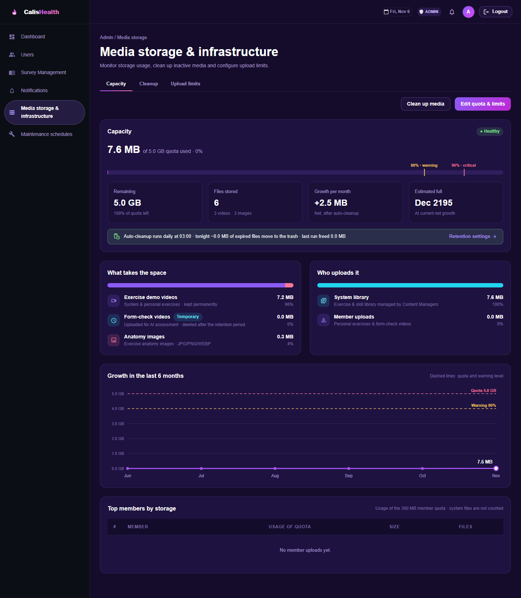
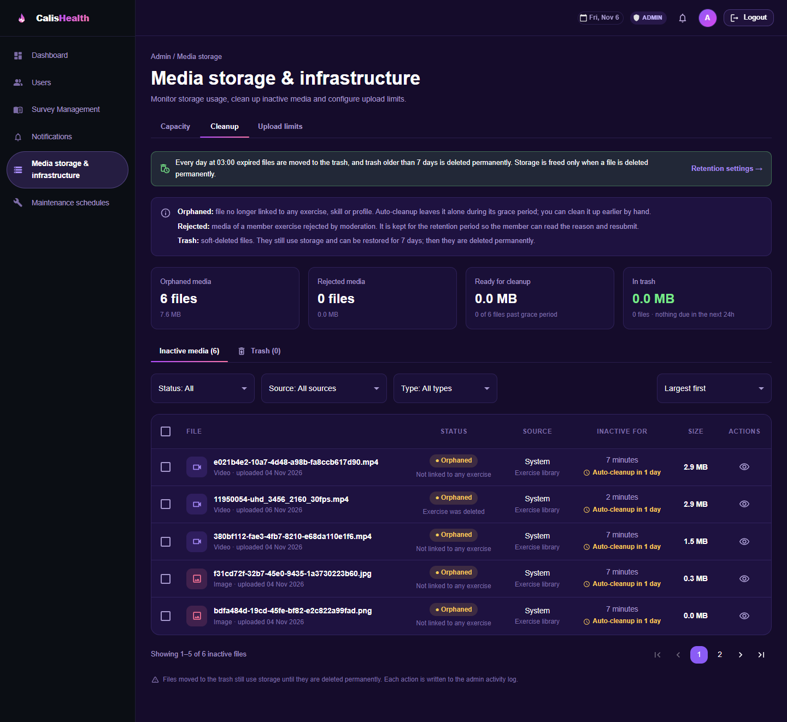
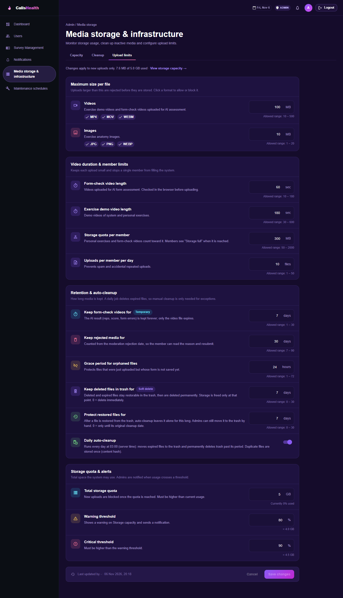
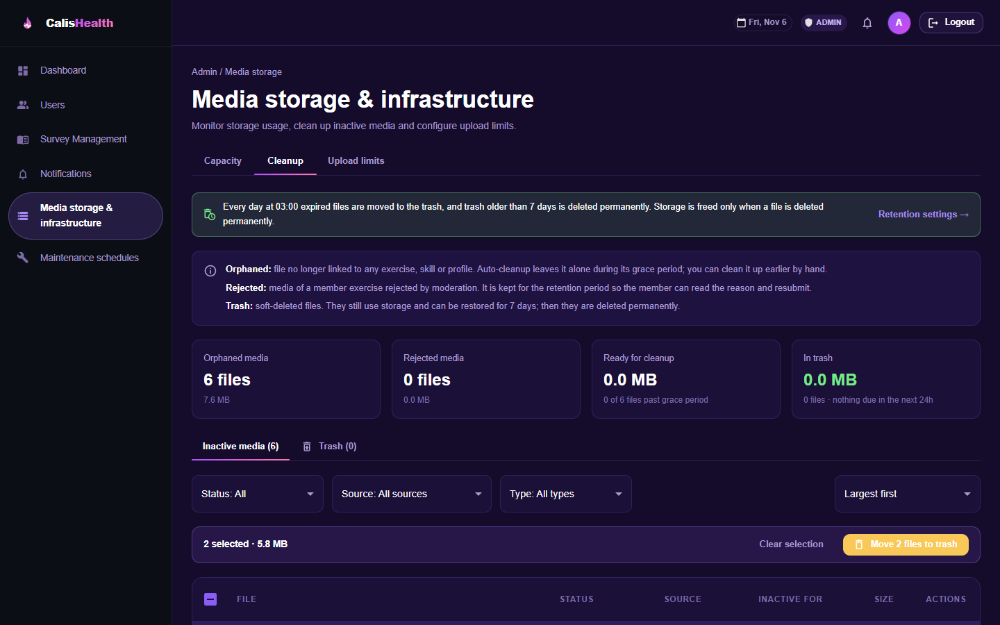
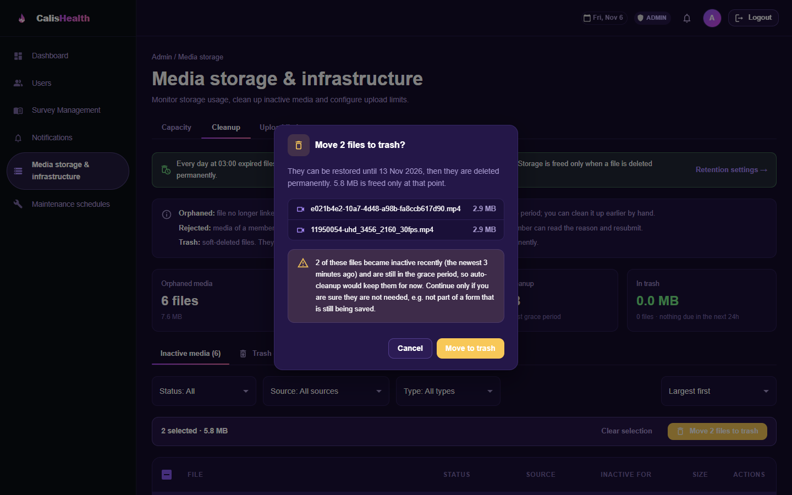
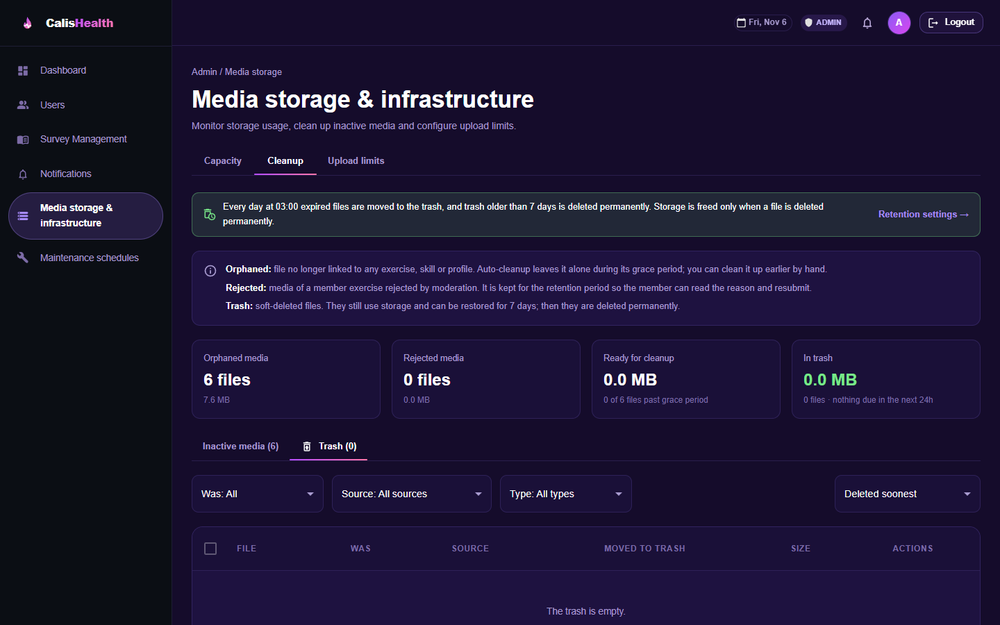

## SGC-186 / 187 / 188 – Admin › Media storage & infrastructure

Admins can now see how much storage the system uses, clean up media that no exercise uses any more, and configure upload limits and retention.

### What's included
- **Capacity** (`/admin/storage`): quota usage bar with warning/critical marks, remaining space, file count, monthly growth, estimated full date, breakdown by file type and by uploader, 6‑month growth chart, top members by storage. Shows a "can be freed" alert once usage passes the critical threshold.
- **Cleanup** (`/admin/storage/cleanup`): inactive media (Orphaned / Rejected) and Trash, with filters, sort, preview, move to trash, restore, delete permanently, empty trash and extend retention. Admins can move a file to the trash during its grace period; the dialog warns when files became inactive recently.
- **Upload limits** (`/admin/storage/settings`): max video/image size and allowed formats, video length, member quota, uploads per day, retention periods (form-check videos, rejected media, orphan grace period, trash, protection after restore), daily auto-cleanup switch, total quota and alert thresholds.
- **Storage backend**: uploads go to Cloudinary (or the local disk when Cloudinary is not configured). Identical files are stored once (SHA-256). Every file is registered in `media_files` with a lifecycle: Active → Orphaned / Rejected → Trash → Purged.
- **Daily job at 03:00**: reconciles the registry with disk and Cloudinary, moves expired files to the trash and permanently deletes trash older than the retention period.
- **Fix**: reloading a page no longer logs the user out (`main.jsx` no longer clears the token on start).

### Database
- `V64__media_storage_management.sql`: extends `media_files` and adds `storage_settings`.
- `V65__storage_restore_grace_days.sql`: adds `restore_grace_days` (default 7).

Both were renumbered after V63 so they don't clash with migrations already on `main`. A local database that ran the earlier V34/V35 media migrations needs to be recreated, or its `flyway_schema_history` fixed.

### Configuration
`app.cloudinary.*` in `application.yml` (env: `CLOUDINARY_CLOUD_NAME`, `CLOUDINARY_API_KEY`, `CLOUDINARY_API_SECRET`, `CLOUDINARY_FOLDER`). Leave the cloud name blank to store uploads on the local disk.

### Screenshots
**Capacity**

**Cleanup – inactive media**

**Upload limits**

**Cleanup – files selected**

**Move to trash (grace-period warning)**

**Media preview**

**Cleanup – trash**

### How to test
1. Log in as an admin and open **Media storage & infrastructure**.
2. Create or edit an exercise with a demo video, then replace the video or delete the exercise: the old file appears under **Cleanup › Inactive media** as Orphaned.
3. Select it and choose **Move to trash**, then restore it from the **Trash** tab.
4. Change a value in **Upload limits**, save, and check that uploads above the new limit are rejected.

### Tests
Backend unit tests pass (205/226). The 21 Spring context tests need a database migrated with the renumbered V64/V65; on a fresh database they start normally. Frontend build passes.
